# 国策图、关系与模块 {#_1}

`FocusGraph` 把每个国策的奖励、前置条件和互斥关系写在一起；`FocusNodes` 把一段国策封装为可复用模块。它们直接使用普通 TypeScript 的类型推导和补全，编辑器不需要专用语言服务器。

## 图的节点与路线 {#_2}

`FocusGraph` 描述封闭、无环的本地图。节点内写奖励、`requires` 和 `exclusiveWith`，返回值提供具有稳定 ID 的句柄。实际从零构建的步骤见[国策与行动教程](../tutorials/focus-and-action.md)；本页集中说明关系、类型和原生降级规则。



[图的 Mermaid 源文件](../assets/focus-authoring.mmd)。图示来自既有国策语义示例：国策完成记录会累积，分叉不自动互斥，贸易与任一政治路线可以并行完成。只有明确的互斥关系才禁止共存。

`requires` 使用本图 selector，例如 `requires: f => f.charter`。输出句柄如 `tree.focuses.charter` 供 `hasCompletedFocus`、`completeFocus` 和原生 ID 使用，不能替代 selector。拼错节点、空 `all` / `any`、混用两种组对象会在类型检查中报错。

[下载图中整棵树的可编译 Krieg 源码](../assets/focus-authoring.krg.ts)。

## 前置条件与原生语义一一对应 {#_3}

| 节点内声明                                         | 生成到该国策上的原生条件                                                                        |
| -------------------------------------------------- | ----------------------------------------------------------------------------------------------- |
| `requires: f => f.charter`                         | `prerequisite = { focus = REC_charter }`                                                        |
| `requires: f => ({ any: [f.industry, f.relief] })` | **一个块**：`prerequisite = { focus = REC_industry focus = REC_relief }`                        |
| `requires: f => ({ all: [f.assembly, f.trade] })`  | **两个块**：`prerequisite = { focus = REC_assembly }` 与 `prerequisite = { focus = REC_trade }` |
| `exclusiveWith: f => f.relief`                     | 当前节点排斥 relief，relief 也排斥当前节点                                                      |

不同 `prerequisite` 块之间是 AND；同一块中的多个 `focus` 是 OR。分叉本身不产生互斥，`any` 合流也不产生互斥。

复杂条件可以嵌套，例如 `requires: f => ({ all: [f.trade, { any: [f.industry, f.relief] }] })` 表示“贸易，并且产业或救济”。`any: [{ all: [f.a, f.b] }, { all: [f.c, f.d] }]` 表示“a 与 b，或者 c 与 d”；编译器保留该逻辑，展开为四个原生前置块 `(a OR c) AND (a OR d) AND (b OR c) AND (b OR d)`。重复项和被更强条件涵盖的项会化简。

为了避免分配律引发指数膨胀，单个 `requires` 的中间展开至多允许 256 个前置组、4096 个节点引用、16384 次组组合和 64 层嵌套。超出时给出 `KRG2610`，不会截断条件或生成部分文件；应简化条件或拆成有玩法意义的中间国策。

## 模块、稳定 ID 和布局 {#id}

`FocusNodes({...})` 只返回有类型的节点模块，本身不生成国策树。用对象展开组合模块，最后在 `FocusGraph` 中用本图 selector 连接它们的终点。同一个模块可以被不同图使用，各图有自己的前缀和最终句柄。模块内部可以相互引用；从模块外附加后继时，直接把 `requires` 写在消费图的后继节点上。

模块也可以由普通函数产生，并显式接收事件句柄、成本或奖励等参数。完整原版示例的 [focus-nodes.krg.ts](https://github.com/maxmixalex/krieg-lang/blob/main/examples/vanilla-complete/src/focus-nodes.krg.ts) 导出 `civicInfrastructure(report)`，返回 charter → harbour；[programme.krg.ts](https://github.com/maxmixalex/krieg-lang/blob/main/examples/vanilla-complete/src/programme.krg.ts) 将其与债券路线组合，最后要求同时完成港口和债券。每个模块拥有自己的节点名，合并到同一棵树时不要重名。

不要把模块注解为 `Record<string, FocusNodeSpec>`：它会丢失实际键名。优先使用 `FocusNodes` 保留名称和回调类型；原有 `FocusNodeSpec` 仍可用于不包含拓扑的通用奖励/外观配置。

生成 ID 为 `${prefix}_${节点名}`，缺省前缀为树的 `id`。调整声明顺序不会改变 ID，`reconstruction.focuses.congress.id` 的类型是字面量 `"REC_congress"`。`country.hasCompletedFocus(...)` 检查完成记录，`country.completeFocus(...)` 生成原生 `complete_national_focus`；原生数据字段需要字符串时可取 `.id`。

默认布局按最长前置链计算行号，同一行按声明顺序排列，列间距 2、行间距 1。`layout: { columnSpacing: 4, rowSpacing: 2 }` 调整间距，节点的 `position: { x: 1, y: 2 }` 指定绝对坐标。间距须为正数，坐标须为有限数。`cost` 是国策点数，通常每点七天，由 `NFocus.FOCUS_POINT_DAYS` 决定。

编译器检查空图、自引用、前置环、重复选择项、重复生成 ID，以及能证明的互斥前置死锁。OR 分支只保留共同必经祖先，合法替代路线不会被当成全部必须完成；这些是保守的结构检查，不是对全部 `available` / `bypass` 脚本进行可达性证明。此 API 描述封闭、无环的本地国策图；共享国策、外部前置和依靠脚本强制完成的特殊结构，使用 `FocusTree` 或原生 API。

回调可引用本图输出句柄；遇到 TypeScript 的循环类型推导时，给该回调标明返回类型，例如 `available: (country): boolean => country.hasCompletedFocus(tree.focuses.charter)`。拓扑本身使用 `requires` 的 selector，不需要这种自引用。

## 从真实编译结果预览 {#_4}

```sh
krieg graph examples/vanilla-complete --focus civ_island_tree
krieg graph examples/kaiserreich-complete --focus srd_island_tree --out srd-tree.mmd
```

命令校验当前源文件与项目依赖，从本次成功编译的 `common/national_focus` 原生内容生成 Mermaid。默认写到标准输出；`--out` 保存 `.mmd`，`--json` 返回结构化结果。不会写入模组目录，也不会执行作者的 TypeScript。编译失败时不会拿旧产物冒充当前图，已有 `.mmd` 保留。

图中 AND 门代表所有前置组，OR 门代表一个组中的多个可选国策；对称互斥显示为一条点线，原生的单向排斥保留箭头。图支持 `FocusGraph`、低层 `FocusTree` 和原生 PDX 声明。输入中存在的 shared/joint 分支会展开；没有定义的前置或互斥目标显示为 `External: ...` 虚线节点。它只展示当前项目输出，未提供的游戏本体或其他模组定义保持外部节点。原生 ID 只进入已转义的标签，不能变成 Mermaid 指令。

程序入口是 `import { renderFocusTreeMermaid } from "krieg-lang/compiler"`，传入解析/编译所得的 `PdxDocument` 和树 ID。要解析跨文件 shared/joint 分支，将相关国策文件的 `document.items` 合并后传入。多个同名树或未指定唯一树时会明确报错。

预览展示静态关系，不模拟 `available`、`bypass`、`allow_branch`、脚本强制完成、本地化或游戏中的坐标布局；这些限制也写进导出的图中。

## 0.3 项目可以逐步迁移 {#03}

`sequences`、`joins`、`choices` 仍受支持，无需一次重写。把 `sequences: [["a", "b"]]` 改成 b 上的 `requires: f => f.a`；把指向 c 的 join 移到 c 的 `requires`；把两项 choice 改成一侧的 `exclusiveWith`。新旧关系并存时，各来源的前置以 AND 组合，相同前置组去重。

原版与 Kaiserreich 完整示例都已经迁移，保留原有国策 ID、坐标、奖励及产业分支的 AND 合流。`tests/focus-authoring.test.mjs` 对比完整原生语义，穷举嵌套表达式的完成组合，并运行普通 TypeScript、LanguageService、跨模块编译和真实 CLI；原来的 `tests/typed-gameplay.test.mjs` 继续检查 0.3 写法兼容性。

## 离线 Wiki 审计依据 {#wiki}

依据用户提供的 `hoi4-modding-source(1).zip`，导出时间为 2026-11-02。以下为包中 manifest 记录的页面修订；本轮未用运行游戏测试代替静态语义验证。

| 页面与修订                                                                                           | 用于确认的规则                                                                                       |
| ---------------------------------------------------------------------------------------------------- | ---------------------------------------------------------------------------------------------------- |
| [National focus modding](https://hoi4.paradoxwikis.com/wiki/National_focus_modding)，revision 105626 | 同一前置组是 OR，不同组是 AND；互斥箭头要求双向关系；重复国策 ID 会破坏连线；cost 单位由 define 决定 |
| [Event modding](https://hoi4.paradoxwikis.com/wiki/Event_modding)，revision 102070                   | 事件数字后缀、命名空间分配、各延时字段相加、国家／新闻事件的共同接收语义、trigger 在投递时检查       |
| [Effect](https://hoi4.paradoxwikis.com/wiki/Effect)，revision 105661                                 | `complete_national_focus` 与 `unlock_national_focus` 等效果的不同用途                                |
