# 带类型的玩法图与事件调度

`FocusGraph` 把每个国策的奖励、前置条件和互斥关系写在一起；`FocusNodes` 把一段国策封装为可复用模块。它们直接使用普通 TypeScript 的类型推导和补全，编辑器不需要专用语言服务器。

## 先按玩法读图，再写节点

这是一条重建路线：宪章之后，产业与救济二选一；贸易可以独立完成。完成任一政治路线解锁议会；最后必须同时完成议会与贸易，才能召开大会。

下图直接由本页完整示例的实际编译结果生成，节点 ID 与源码一一对应；打开文档即可看到，不依赖网页运行 Mermaid。



[下载这张图的 Mermaid 源文件](assets/focus-authoring.mmd)

国策的完成记录会累积；不同路线可以同时推进。只有明确写出的互斥关系才禁止共存。这里贸易与产业、贸易与救济都可以同时完成。

下面是可直接编译的完整声明。将鼠标放在任意 `focus.` 后，都能看到这棵树实际存在的节点；不必在另一张拓扑表里重复节点名。

```typescript
import { CountryEvent, DecisionCategory, FocusGraph, FocusNodes } from "krieg-lang/hoi4";

export const report = CountryEvent({
  id: "reconstruction.1",
  hidden: true,
  isTriggeredOnly: true,
  immediate: (country) => country.effects.addPoliticalPower(50),
});

// 一个可跨文件导出的模块；内部也有精确的节点名补全。
export const infrastructure = FocusNodes({
  charter: { cost: 3 },
  trade: { requires: (focus) => focus.charter, cost: 3 },
});

export const reconstruction = FocusGraph({
  id: "reconstruction_tree",
  prefix: "REC",
  nodes: {
    ...infrastructure,
    industry: {
      requires: (focus) => focus.charter,
      exclusiveWith: (focus) => focus.relief,
      cost: 5,
    },
    relief: {
      requires: (focus) => focus.charter,
      cost: 5,
    },
    assembly: {
      requires: (focus) => ({ any: [focus.industry, focus.relief] }),
      cost: 5,
    },
    congress: {
      requires: (focus) => ({ all: [focus.assembly, focus.trade] }),
      cost: 5,
      completionReward: (country) => country.schedule(report, { hours: 6, randomHours: 3 }),
    },
  },
});

export const decisions = DecisionCategory({
  id: "REC_administration",
  decisions: [
    {
      id: "REC_review",
      cost: 25,
      available: (country) => country.hasCompletedFocus(reconstruction.focuses.congress),
      completeEffect: (country) => country.schedule(report, { days: 1 }),
    },
  ],
});
```

`exclusiveWith` 只需在一侧声明，编译器自动生成双向关系。多个替代项可写成 `exclusiveWith: (focus) => [focus.relief, focus.austerity]`：这让当前节点分别与它们互斥，不会隐式令 relief 与 austerity 互斥。三条路线都互斥时，在 industry 上列出另外两条，再在 relief 上指定 austerity；也可以继续使用 0.3 的 `choices`。

`requires` 选择的是本图节点 `FocusNodeKey`；`reconstruction.focuses.congress` 则是生成后的 `FocusReference<"REC_congress">`，用于效果和触发器。不能把字符串、手写 `{ key: ... }` 或另一棵树的句柄塞进 `requires`。拼错属性、空 `all` / `any`、同一个对象同时指定 `all` 与 `any`，普通 `tsc --noEmit` 就会报错。

## 前置条件与原生语义一一对应

| 节点内声明                                         | 生成到该国策上的原生条件                                                                        |
| -------------------------------------------------- | ----------------------------------------------------------------------------------------------- |
| `requires: f => f.charter`                         | `prerequisite = { focus = REC_charter }`                                                        |
| `requires: f => ({ any: [f.industry, f.relief] })` | **一个块**：`prerequisite = { focus = REC_industry focus = REC_relief }`                        |
| `requires: f => ({ all: [f.assembly, f.trade] })`  | **两个块**：`prerequisite = { focus = REC_assembly }` 与 `prerequisite = { focus = REC_trade }` |
| `exclusiveWith: f => f.relief`                     | 当前节点排斥 relief，relief 也排斥当前节点                                                      |

不同 `prerequisite` 块之间是 AND；同一块中的多个 `focus` 是 OR。分叉本身不产生互斥，`any` 合流也不产生互斥。

复杂条件可以嵌套，例如 `requires: f => ({ all: [f.trade, { any: [f.industry, f.relief] }] })` 表示“贸易，并且产业或救济”。`any: [{ all: [f.a, f.b] }, { all: [f.c, f.d] }]` 表示“a 与 b，或者 c 与 d”；编译器保留该逻辑，展开为四个原生前置块 `(a OR c) AND (a OR d) AND (b OR c) AND (b OR d)`。重复项和被更强条件涵盖的项会化简。

为了避免分配律引发指数膨胀，单个 `requires` 的中间展开至多允许 256 个前置组、4096 个节点引用、16384 次组组合和 64 层嵌套。超出时给出 `KRG2610`，不会截断条件或生成部分文件；应简化条件或拆成有玩法意义的中间国策。

## 模块、稳定 ID 和布局

`FocusNodes({...})` 只返回有类型的节点模块，本身不生成国策树。用对象展开组合模块，最后在 `FocusGraph` 中用本图 selector 连接它们的终点。同一个模块可以被不同图使用，各图有自己的前缀和最终句柄。模块内部可以相互引用；从模块外附加后继时，直接把 `requires` 写在消费图的后继节点上。

模块也可以由普通函数产生，并显式接收事件句柄、成本或奖励等参数。完整原版示例的 [focus-nodes.krg.ts](https://github.com/maxmixalex/krieg-lang/blob/main/examples/vanilla-complete/src/focus-nodes.krg.ts) 导出 `civicInfrastructure(report)`，返回 charter → harbour；[programme.krg.ts](https://github.com/maxmixalex/krieg-lang/blob/main/examples/vanilla-complete/src/programme.krg.ts) 将其与债券路线组合，最后要求同时完成港口和债券。每个模块拥有自己的节点名，合并到同一棵树时不要重名。

不要把模块注解为 `Record<string, FocusNodeSpec>`：它会丢失实际键名。优先使用 `FocusNodes` 保留名称和回调类型；原有 `FocusNodeSpec` 仍可用于不包含拓扑的通用奖励/外观配置。

生成 ID 为 `${prefix}_${节点名}`，缺省前缀为树的 `id`。调整声明顺序不会改变 ID，`reconstruction.focuses.congress.id` 的类型是字面量 `"REC_congress"`。`country.hasCompletedFocus(...)` 检查完成记录，`country.completeFocus(...)` 生成原生 `complete_national_focus`；原生数据字段需要字符串时可取 `.id`。

默认布局按最长前置链计算行号，同一行按声明顺序排列，列间距 2、行间距 1。`layout: { columnSpacing: 4, rowSpacing: 2 }` 调整间距，节点的 `position: { x: 1, y: 2 }` 指定绝对坐标。间距须为正数，坐标须为有限数。`cost` 是国策点数，通常每点七天，由 `NFocus.FOCUS_POINT_DAYS` 决定。

编译器检查空图、自引用、前置环、重复选择项、重复生成 ID，以及能证明的互斥前置死锁。OR 分支只保留共同必经祖先，合法替代路线不会被当成全部必须完成；这些是保守的结构检查，不是对全部 `available` / `bypass` 脚本进行可达性证明。此 API 描述封闭、无环的本地国策图；共享国策、外部前置和依靠脚本强制完成的特殊结构，使用 `FocusTree` 或原生 API。

回调可引用本图输出句柄；遇到 TypeScript 的循环类型推导时，给该回调标明返回类型，例如 `available: (country): boolean => country.hasCompletedFocus(tree.focuses.charter)`。拓扑本身使用 `requires` 的 selector，不需要这种自引用。

## 从真实编译结果预览

```sh
krieg graph examples/vanilla-complete --focus civ_island_tree
krieg graph examples/kaiserreich-complete --focus srd_island_tree --out srd-tree.mmd
```

命令校验当前源文件与项目依赖，从本次成功编译的 `common/national_focus` 原生内容生成 Mermaid。默认写到标准输出；`--out` 保存 `.mmd`，`--json` 返回结构化结果。不会写入模组目录，也不会执行作者的 TypeScript。编译失败时不会拿旧产物冒充当前图，已有 `.mmd` 保留。

图中 AND 门代表所有前置组，OR 门代表一个组中的多个可选国策；对称互斥显示为一条点线，原生的单向排斥保留箭头。图支持 `FocusGraph`、低层 `FocusTree` 和原生 PDX 声明。输入中存在的 shared/joint 分支会展开；没有定义的前置或互斥目标显示为 `External: ...` 虚线节点。它只展示当前项目输出，未提供的游戏本体或其他模组定义保持外部节点。原生 ID 只进入已转义的标签，不能变成 Mermaid 指令。

程序入口是 `import { renderFocusTreeMermaid } from "krieg-lang/compiler"`，传入解析/编译所得的 `PdxDocument` 和树 ID。要解析跨文件 shared/joint 分支，将相关国策文件的 `document.items` 合并后传入。多个同名树或未指定唯一树时会明确报错。

预览展示静态关系，不模拟 `available`、`bypass`、`allow_branch`、脚本强制完成、本地化或游戏中的坐标布局；这些限制也写进导出的图中。

## 0.3 项目可以逐步迁移

`sequences`、`joins`、`choices` 仍受支持，无需一次重写。把 `sequences: [["a", "b"]]` 改成 b 上的 `requires: f => f.a`；把指向 c 的 join 移到 c 的 `requires`；把两项 choice 改成一侧的 `exclusiveWith`。新旧关系并存时，各来源的前置以 AND 组合，相同前置组去重。

原版与 Kaiserreich 完整示例都已经迁移，保留原有国策 ID、坐标、奖励及产业分支的 AND 合流。`tests/focus-authoring.test.mjs` 对比完整原生语义，穷举嵌套表达式的完成组合，并运行普通 TypeScript、LanguageService、跨模块编译和真实 CLI；原来的 `tests/typed-gameplay.test.mjs` 继续检查 0.3 写法兼容性。

## 事件句柄与接收作用域

```typescript
import { CountryEvent, StateEvent, ScriptedEffect, state } from "krieg-lang/hoi4";

export const report = CountryEvent({
  id: "harbour.1",
  hidden: true,
  isTriggeredOnly: true,
  immediate: (country) => country.schedule(followup, { days: 2 }),
});

export const followup = CountryEvent({
  id: "harbour.2",
  hidden: true,
  isTriggeredOnly: true,
  immediate: (country) => country.effects.addStability(0.02),
});

export const inspection = StateEvent({
  id: "harbour.3",
  hidden: true,
  isTriggeredOnly: true,
  immediate: (location) => location.effects.addManpower(100),
});

export const launch = ScriptedEffect("launch_inspection", (country) => {
  country.schedule(report, { days: 1 });
  country.state(state(1), (location) => location.schedule(inspection));
});
```

`CountryEvent` 和 `NewsEvent` 返回 `EventDefinition<"country", ID>`，`StateEvent` 返回 `EventDefinition<"state", ID>`。因此 `country.schedule(inspection)`、`location.schedule(report)`、传入 Idea 句柄或手写 `{ id: "harbour.1" }` 都不能通过普通 TypeScript 检查。国家作用域只显示国家操作，州作用域只显示州操作。

| 调度字段                     | 原生输出与含义                                                 |
| ---------------------------- | -------------------------------------------------------------- |
| `hours` / `days` / `months`  | 固定延时，所有字段相加；游戏按每月 30 天计算                   |
| `randomHours` / `randomDays` | 对应 `random_hours` / `random_days`，额外随机量从 0 到指定上限 |
| 省略延时                     | 立即发送事件                                                   |

数值必须是非负、静态、安全整数。编译器拒绝负数、小数及游戏运行时变量，而不把它们伪装成静态时间。调度本身不会修改事件的 `isTriggeredOnly`：需要仅由效果发送的事件，应显式设置该字段。延时事件在投递时重新检查事件 trigger；接收国家尚不存在时，延时计时会暂停。

前向引用、跨模块事件链和有延时的循环链都能编译。编译器先保存事件身份，再翻译回调；调度生成事件 ID 调用，不内联事件内容，因此不会把游戏运行时循环展开成编译时递归。是否应该循环、何时停止仍由你的玩法条件决定。捕获祖先作用域后调用 `schedule` 或国策句柄操作，会按已有作用域规则生成 `PREV` / `PREV.PREV`。

事件 ID 使用字面量泛型检查最后一个点之后的十进制数字串，支持点分命名空间和前导零。原版的 `SEA_japan_air_accidents_events.01`、KR 的 `japan_legations_crisis_events.000` 与 `UPC.chinademocraticleague.001` 都保留原拼写；负号、十六进制和指数形式在普通 TypeScript 中被拒绝。编译器再检查命名空间字符，并按数字身份识别重复事件：`example.1` 和 `example.001` 会发生冲突。大于 99999 的后缀与游戏保持兼容，但给出 `KRG2609` 警告，因为它会越过命名空间的内部 ID 分配区间。语义事件与国策声明在同一次编译中不能重复 ID；这不是对所有已安装模组或独立编译入口的全局冲突扫描。

原有 `effects.country_event`、`effects.countryEvent` 和原生数据字段仍可接收字符串，以便引用原版或其他模组已有内容。这些字符串不会获得新句柄的接收作用域检查；新编写的语义事件优先通过 `schedule` 组合。

## 离线 Wiki 审计依据

依据用户提供的 `hoi4-modding-source(1).zip`，导出时间为 2026-11-02。以下为包中 manifest 记录的页面修订；本轮未用运行游戏测试代替静态语义验证。

| 页面与修订                                                                                           | 用于确认的规则                                                                                       |
| ---------------------------------------------------------------------------------------------------- | ---------------------------------------------------------------------------------------------------- |
| [National focus modding](https://hoi4.paradoxwikis.com/wiki/National_focus_modding)，revision 105626 | 同一前置组是 OR，不同组是 AND；互斥箭头要求双向关系；重复国策 ID 会破坏连线；cost 单位由 define 决定 |
| [Event modding](https://hoi4.paradoxwikis.com/wiki/Event_modding)，revision 102070                   | 事件数字后缀、命名空间分配、各延时字段相加、国家／新闻事件的共同接收语义、trigger 在投递时检查       |
| [Effect](https://hoi4.paradoxwikis.com/wiki/Effect)，revision 105661                                 | `complete_national_focus` 与 `unlock_national_focus` 等效果的不同用途                                |
